# ThinkNex Docs · Compartición segura y auditable de documentos

[](https://github.com/samilr/thinknex-docshare/actions/workflows/ci.yml)
[](https://github.com/samilr/thinknex-docshare/actions/workflows/deploy.yml)


El sistema permite compartir documentos del sistema documental existente **de forma segura**,
registrando **quién** los compartió, **cuándo** y **por qué medio**. Además incluye un
**asistente de IA con RAG** que responde con citas y opera la plataforma sin saltarse los permisos.

> Prototipo de prueba · datos ficticios

**Demo en línea, desplegada en Google Cloud:**
https://docshare-web-218254181516.southamerica-west1.run.app
(credenciales en el correo de entrega · servicios activos en
[Demo en Google Cloud](#demo-en-google-cloud))

| API en producción (share-api) | URL |
|---|---|
| Swagger UI | https://docshare-share-api-218254181516.southamerica-west1.run.app/docs |
| ReDoc | https://docshare-share-api-218254181516.southamerica-west1.run.app/redoc |
| OpenAPI (JSON) | https://docshare-share-api-218254181516.southamerica-west1.run.app/openapi.json |
| Health check (liveness) | https://docshare-share-api-218254181516.southamerica-west1.run.app/health |
| Readiness (base de datos, storage y DMS) | https://docshare-share-api-218254181516.southamerica-west1.run.app/ready |

Los endpoints de negocio requieren un **JWT** y el **rol** adecuado. En Swagger, *Authorize* inicia
sesión con una cuenta de demo ([seguridad de la API](#api-autenticación-con-jwt-y-control-de-acceso-por-roles)).

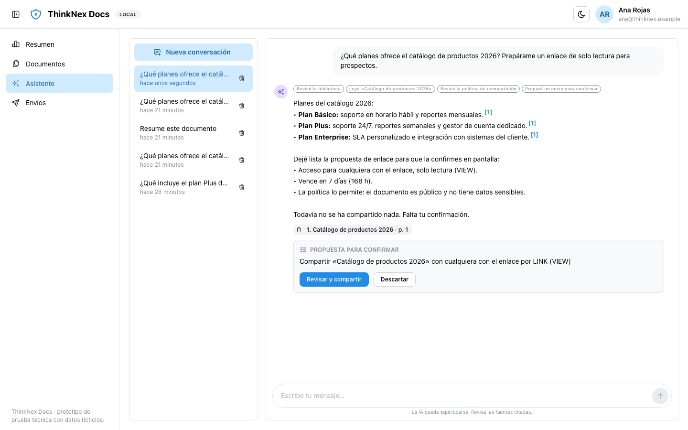

---

## Cómo revisar esta entrega

Todo se puede revisar en línea, sin instalar nada. Las contraseñas de las tres cuentas van en el
correo de entrega.

| Tiempo | Qué revisar |
|---|---|
| **5 minutos** | El portal en producción con el recorrido de abajo (pasos 1 a 3) |
| **20 minutos** | El recorrido completo, más [Análisis](docs/01-analisis.md), [Diseño](docs/02-diseno.md) y [Modelo de datos](docs/03-modelo-datos.md) |
| **Revisión técnica** | La [API en Swagger](https://docshare-share-api-218254181516.southamerica-west1.run.app/docs), los [ADRs](docs/adr/), el código en [`services/`](services/) y [`web/`](web/), y las [ejecuciones de CI/CD](https://github.com/samilr/thinknex-docshare/actions) |

### Accesos en producción

| Qué | URL | Cuenta |
|---|---|---|
| Portal | https://docshare-web-218254181516.southamerica-west1.run.app | `ana@thinknex.example` (emisora), `carla@thinknex.example` (auditora), `admin@thinknex.example` (administrador) |
| API (Swagger) | https://docshare-share-api-218254181516.southamerica-west1.run.app/docs | La misma cuenta, con el botón *Authorize* (email en *username*) |
| Estado del servicio | https://docshare-share-api-218254181516.southamerica-west1.run.app/health y https://docshare-share-api-218254181516.southamerica-west1.run.app/ready | Público |

El primer acceso tras un rato sin uso puede tardar unos segundos, porque los servicios escalan a cero.

### Recorrido sugerido en el portal

1. **Compartir con revisión de seguridad.** Entra como `ana@`. En *Documentos → Comercial →
   Certificados*, abre el certificado de cliente y pulsa **Compartir**. Elige *Email*, un
   destinatario externo y un motivo, y pulsa **Revisar seguridad**: el sistema detecta RUT,
   teléfono y tarjeta y exige confirmación antes de enviar.
2. **Enlace para cualquiera, en modo solo ver.** En *Marketing*, abre el *Catálogo de productos
   2026* y compártelo con **Enlace ThinkNex Docs**, *Cualquiera con el enlace* y *Solo ver*. Copia el
   enlace y ábrelo en una ventana privada: el visor muestra páginas con marca de agua, sin botón de
   descarga.
3. **Asistente de IA.** Pulsa el botón flotante y pregunta *"¿Qué planes ofrece el catálogo de
   productos 2026?"*. La respuesta trae citas que abren la página fuente. Después pide *"prepárame
   un enlace de solo lectura para prospectos"*: el asistente prepara una propuesta, pero no
   comparte nada hasta que confirmas.
4. **El destinatario con código OTP.** Entra como `admin@` y abre *Bandeja simulada*: ahí llegan
   los correos, WhatsApp y SMS de la demo. En el envío del paso 1, pulsa **Abrir como
   destinatario**, luego **Enviarme el código**, y usa el código que aparece en la bandeja.
5. **Auditoría.** Entra como `carla@` y abre *Auditoría*: verás la cadena íntegra verificada,
   quién compartió qué, cuándo, por qué medio y desde qué IP, con filtros y **Exportar CSV**.
6. **Administración.** Como `admin@`, revisa *Políticas* (crear, editar o desactivar reglas) y
   *Usuarios → Actuar como este usuario* para probar la plataforma con la identidad de otra
   persona, con la acción auditada.

### Dónde está cada entregable

| Entregable | Contenido | Dónde |
|---|---|---|
| **Análisis** | Necesidad, preguntas, supuestos, riesgos, alcance y prioridades | [docs/01-analisis.md](docs/01-analisis.md) |
| **Diseño** | Arquitectura, componentes, responsabilidades, flujos y justificación | [docs/02-diseno.md](docs/02-diseno.md) y [14 ADRs](docs/adr/) |
| **Modelo de datos** | Entidades, relaciones e invariantes | [docs/03-modelo-datos.md](docs/03-modelo-datos.md) y [migraciones](services/share-api/app/db/migrations/versions/) |
| **Prototipo** | Flujo elegido y su justificación, código ejecutable y demo en línea | [docs/04-prototipo.md](docs/04-prototipo.md), [`services/`](services/), [`web/`](web/) y el [portal](https://docshare-web-218254181516.southamerica-west1.run.app) |
| **Documentación** | Ejecución, decisiones, limitaciones y pendientes | Este README, [docs/04](docs/04-prototipo.md), [docs/05](docs/05-limitaciones-y-roadmap.md) y los [ADRs](docs/adr/) |
| **IA (RAG y asistente)** | Arquitectura, seguridad, costos y pruebas | [docs/08-ia.md](docs/08-ia.md) |

---

## Contenido

- [Cómo revisar esta entrega](#cómo-revisar-esta-entrega)
- [Resumen técnico](#resumen-técnico)
- [Demo en Google Cloud](#demo-en-google-cloud)
- [Capturas](#capturas)
- [Arquitectura](#arquitectura)
- [IA: RAG y asistente agéntico](#ia-rag-y-asistente-agéntico)
- [Seguridad](#seguridad)
  - [API: autenticación con JWT y control de acceso por roles](#api-autenticación-con-jwt-y-control-de-acceso-por-roles)
- [Levantar el proyecto en local](#levantar-el-proyecto-en-local)
- [Tests y calidad](#tests-y-calidad)
- [Despliegue en Google Cloud](#despliegue-en-google-cloud)
  - [CI/CD con GitHub Actions](#cicd-con-github-actions)
- [Estructura del repositorio](#estructura-del-repositorio)
- [Documentación](#documentación)

---

## Resumen técnico

**El documento nunca viaja por el canal.** El destinatario recibe un enlace, valida su identidad
con un código de un solo uso y abre el documento en el visor con el permiso que eligió quien
comparte: ver, ver y descargar, o editar. Cada paso queda en una auditoría encadenada por hash.

| Área | Implementación |
|---|---|
| **Compartir** | Email, WhatsApp, SMS o enlace copiable. Motivo obligatorio, vencimiento (72 h por defecto, 7 días máx.) y límite de accesos. Revocar, regenerar el enlace y editar el acceso después de enviado |
| **Snapshots inmutables** | Se comparte una copia verificada por `sha256` contra el DMS. Si el original cambia, lo enviado no cambia (salvo con el permiso *Editar*) |
| **Visor protegido** | *Solo ver* entrega páginas renderizadas en el servidor (pypdfium2) con marca de agua del destinatario: el archivo original nunca sale |
| **Política de sensibilidad** | Detectores de datos personales chilenos (RUT con dígito verificador, teléfono, tarjeta, cuenta) × clasificación × destinatario interno o externo → permitir, advertir o bloquear. Las reglas las edita el ADMIN y cada cambio queda auditado |
| **Auditoría** | Append-only (un trigger de Postgres bloquea `UPDATE` y `DELETE`), encadenada por hash y verificable en `/api/v1/audit/verify`. Exportación a CSV |
| **Seguridad de la API** | Autenticación con **JWT Bearer** (15 min) y refresh rotativo en cookie `HttpOnly`. **Control de acceso por roles** (ADMIN, SHARER, AUDITOR) en cada endpoint, más chequeo de propiedad del recurso. argon2id y "actuar como otro usuario" auditado (claim `act`) |
| **RAG** | pgvector (HNSW) + texto completo en español, fusión RRF, **permisos aplicados en el SQL**, citas nativas de Claude que abren la página exacta |
| **Agente** | Bucle de tool use propio con herramientas tipadas por rol. Las acciones solo se **proponen**: una persona las confirma en la interfaz |
| **Infraestructura** | Terraform completo en GCP: Cloud Run (servicios y jobs), Cloud SQL, Cloud Storage, Secret Manager, Scheduler, Vertex AI. CI/CD con GitHub Actions: pruebas en cada push y despliegue continuo a Cloud Run con Workload Identity Federation |

**Stack:** Python 3.12 · FastAPI · SQLAlchemy 2 + Alembic · PostgreSQL 17 + pgvector · React 19 ·
TypeScript · Vite · Mantine · TanStack Query · cliente tipado desde OpenAPI · Anthropic SDK
(Claude Sonnet 5.5 y Haiku 5.5) · Vertex AI `gemini-embedding-001` · Docker · nginx · Terraform ·
GitHub Actions.

## Demo en Google Cloud

La demo corre completa en un proyecto de Google Cloud, en **Santiago
(`southamerica-west1`)**. Toda la infraestructura está creada con Terraform
([`infra/terraform`](infra/terraform)) y **se despliega automáticamente desde GitHub Actions en cada
push a `main`** ([CI/CD](#cicd-con-github-actions)). También se puede desplegar a mano con
`make up APP_ENV=gcp`.

| Servicio de GCP | Recurso activo | Uso |
|---|---|---|
| **Cloud Run** (servicios) | `docshare-web`, `docshare-share-api`, `docshare-document-api` | Portal (nginx + React), API de la solución y sistema documental simulado. Sondas HTTP de arranque y de vida contra `/health` (`/healthz` en el portal). Escalan a cero: el primer acceso tras un rato sin uso tarda unos segundos |
| **Cloud Run** (jobs) | `docshare-migrate`, `docshare-gc`, `docshare-indexer` | Migraciones de Alembic antes de cada despliegue, retención (vencimiento de envíos y purga de snapshots) e indexación de IA |
| **Cloud SQL** | `docshare-pg`: PostgreSQL 17 con pgvector, bases `share` y `dms` | Envíos, auditoría append-only, índice vectorial y metadatos del sistema documental |
| **Cloud Storage** | Buckets `…-docshare-snapshots` y `…-docshare-dms` | Snapshots inmutables compartidos y archivos del sistema documental |
| **Secret Manager** | 8 secretos (`docshare-jwt-secret`, `docshare-anthropic-api-key`, …) | Credenciales generadas por Terraform y montadas en Cloud Run. Ninguna está en el código |
| **Cloud Scheduler** | `docshare-retention-daily` (04:00) y `docshare-ai-indexer` (cada 10 min) | Dispara los jobs de retención e indexación. Corre en `us-central1` porque no está disponible en Santiago |
| **Vertex AI** | `gemini-embedding-001` en `southamerica-east1` | Embeddings para la búsqueda semántica, autorizados por IAM a la cuenta de servicio |
| **Artifact Registry** | Repositorio Docker `docshare` | Imágenes de los tres servicios |
| **IAM** | Una cuenta de servicio por servicio, con permisos mínimos | Acceso a Cloud SQL, Storage, secretos y Vertex AI sin claves |
| **Workload Identity Federation** | Pool `docshare-github` y cuenta `docshare-deployer` | GitHub Actions despliega sin llaves JSON, solo desde este repositorio |

Fuera de GCP, share-api llama a la **API de Anthropic** (Claude Sonnet 5.5) con fragmentos
redactados.

**Notificaciones en la demo:** los correos, WhatsApp y SMS con el enlace y el código OTP se
entregan en la **Bandeja simulada** del administrador (*Abrir como destinatario*), de modo que el
flujo completo con OTP se puede probar sin cuentas reales. El envío de correos reales ya está
integrado con [Resend](https://resend.com) y se activa con la variable `resend_api_key` de Terraform
([docs/06](docs/06-despliegue-gcp.md)).

## Capturas

**Quien comparte**

| Revisión de seguridad antes de compartir | Envíos con estado, descargas y vencimiento |
|---|---|
| 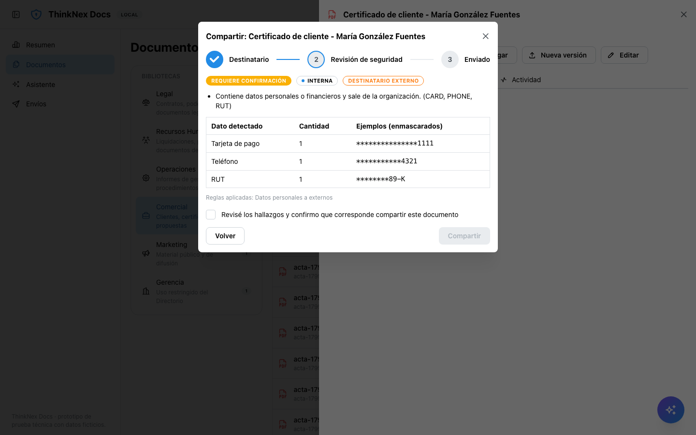 | 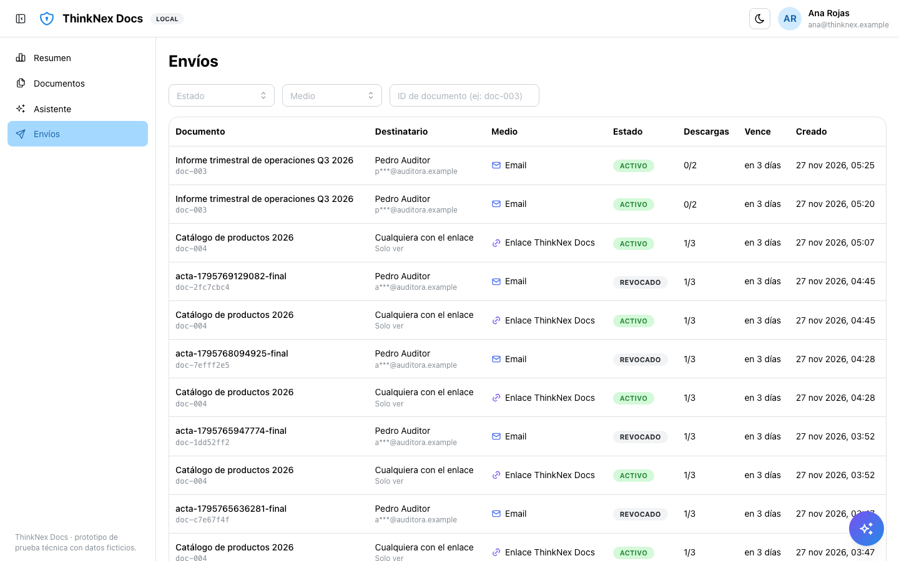 |
| **Quién tiene acceso a un documento, con revocación** | **Actividad del documento** |
| 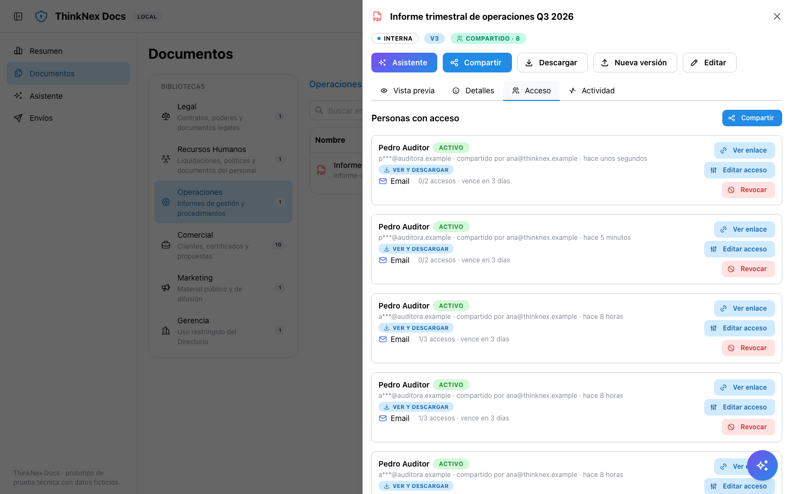 | 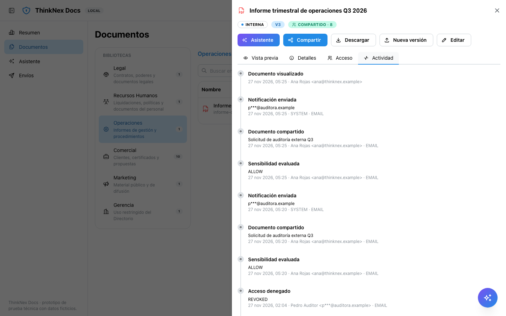 |
| **Editar el acceso de un envío ya hecho** | **Resumen con indicadores navegables** |
| 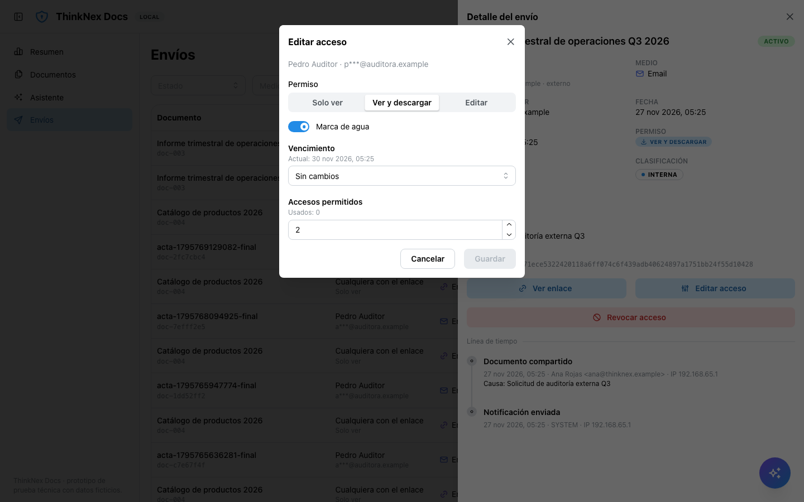 | 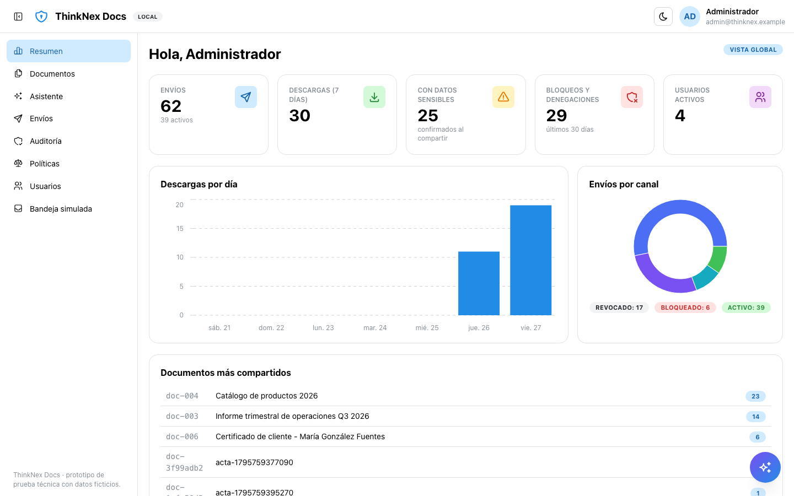 |

**Asistente de IA**

| Página del asistente con conversaciones guardadas | Panel lateral en cualquier pantalla |
|---|---|
|  | 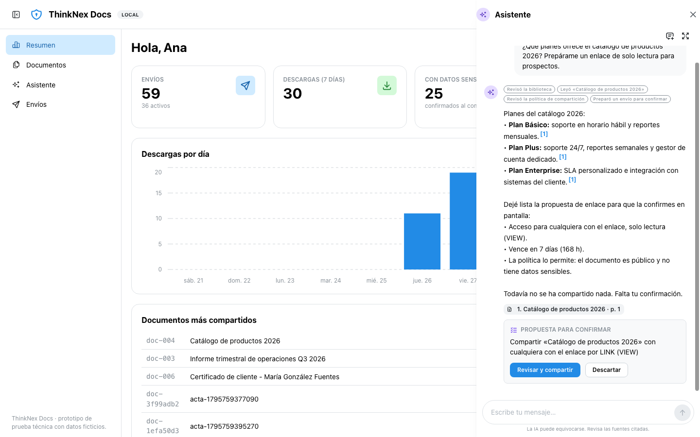 |

**Destinatario**

| Enlace a una persona: pide el código OTP | Visor protegido (solo ver, con marca de agua) |
|---|---|
| 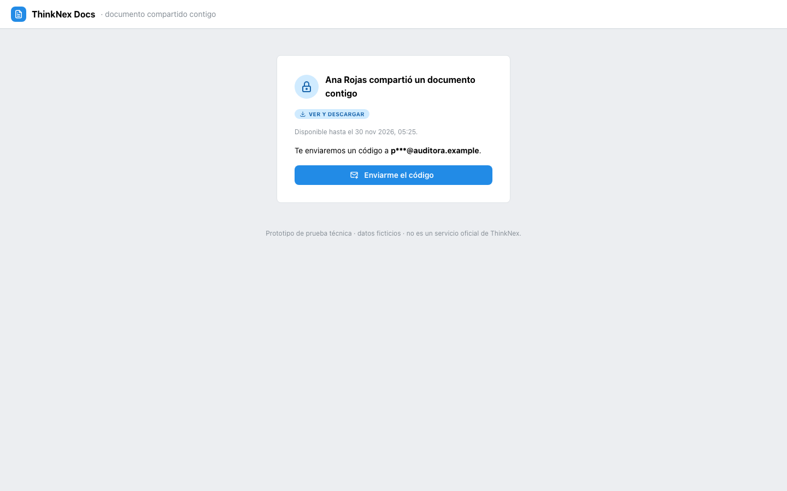 | 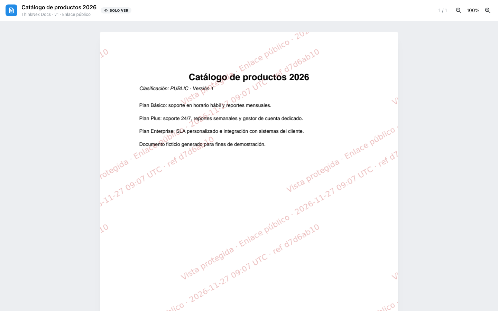 |

**Administración y auditoría**

| Políticas editables | Usuarios y roles |
|---|---|
| 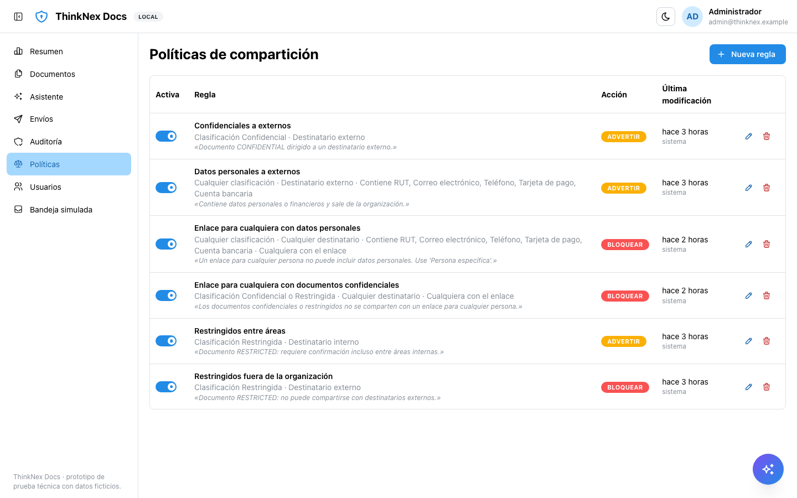 | 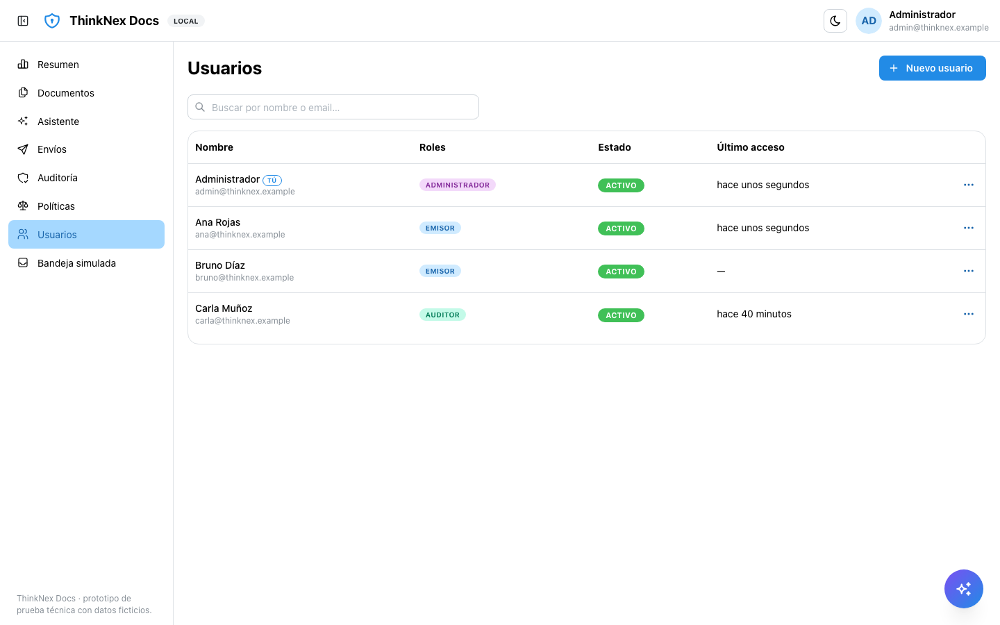 |
| **Actuar como otro usuario (barra superior)** | **Bandeja simulada con enlaces y códigos** |
| 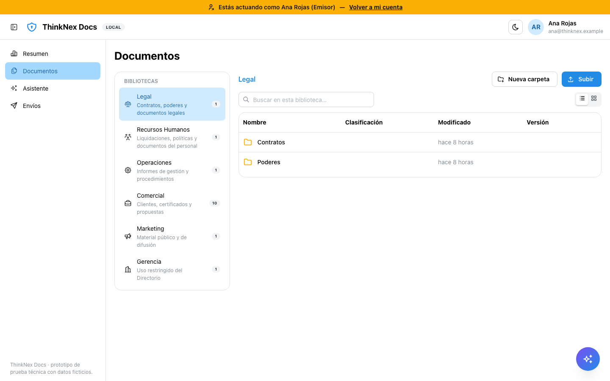 | 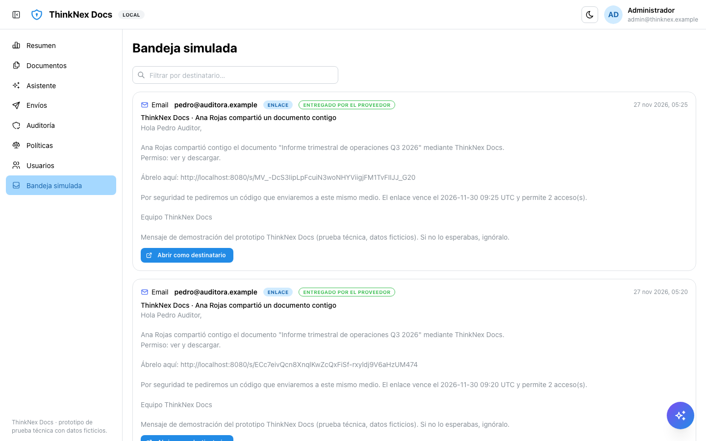 |
| **Auditoría encadenada y verificada** | **Inicio de sesión** |
| 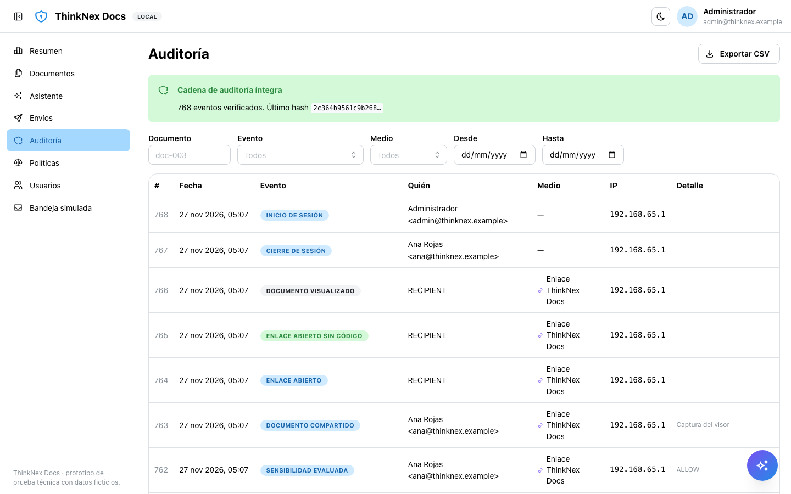 | 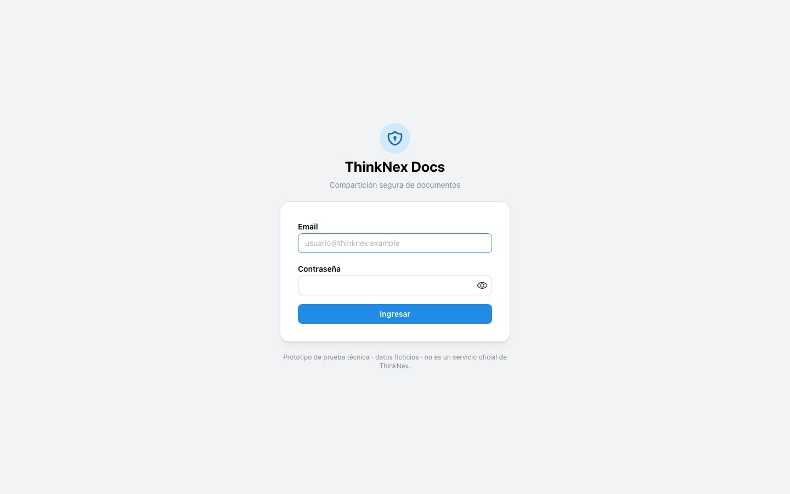 |

## Arquitectura

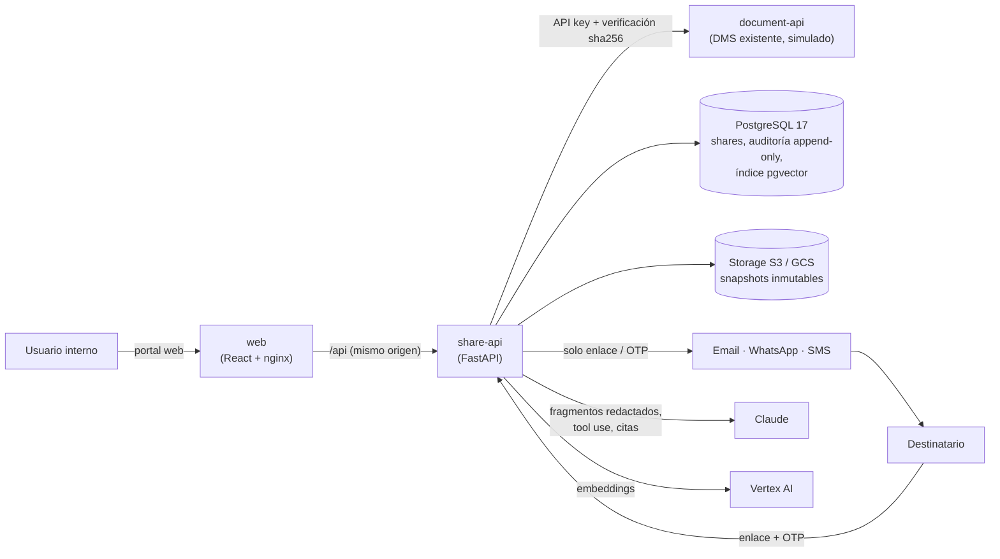

| Componente | Rol |
|---|---|
| [`services/document-api`](services/document-api) | Simula el sistema documental existente (bibliotecas, carpetas, versiones), protegido por API key |
| [`services/share-api`](services/share-api) | La solución: API, política, envíos, accesos, auditoría e IA ([`app/ai`](services/share-api/app/ai)). Monolito modular con puertos y adaptadores |
| [`web`](web) | Portal React servido por nginx, que hace de proxy a `/api` en el mismo origen (sin CORS) |
| [`infra/terraform`](infra/terraform) | Toda la infraestructura de GCP como código |

Decisiones clave, con sus alternativas descartadas, en los [ADRs](docs/adr/): monolito modular,
snapshot inmutable, enlace con OTP, auditoría con hash chain, auth propia con refresh rotativo,
RAG sobre pgvector y asistente con acciones solo como propuestas.

## IA: RAG y asistente agéntico

Detalle completo en [docs/08-ia.md](docs/08-ia.md), [ADR-0013](docs/adr/0013-rag-pgvector-vertex.md)
y [ADR-0014](docs/adr/0014-asistente-agentico.md).

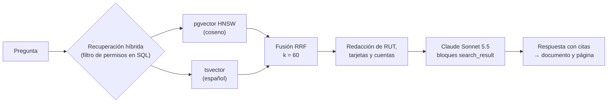

- **Indexación por eventos:** outbox `ai_jobs` procesado tras cada cambio en la biblioteca, más un
  Cloud Run Job programado de respaldo. Sincronización idempotente por `sha256`. Los documentos
  `RESTRICTED` no se indexan.
- **Permisos en la recuperación, no en el prompt:** al modelo nunca le llega un fragmento que el
  usuario no pueda abrir.
- **Citas nativas** (`search_result` + `citations`) en streaming SSE, traducidas a documento y
  página y abiertas en el visor.
- **Agente:** bucle de tool use sobre la Messages API (máx. 8 pasos) con herramientas de lectura
  (buscar, leer, envíos, política, auditoría) y de propuesta (`proponer_envio`,
  `proponer_revocacion`, `proponer_cambio_acceso`). Confirmar llama al endpoint normal, con
  política, OTP y auditoría. Es la defensa frente a prompt injection en los documentos.
- **Conversaciones persistentes**, contexto de la pantalla actual y botón del asistente en cada
  documento.
- **Costos acotados:** prompt caching, presupuesto diario de tokens por usuario y registro en
  `ai_usage`.
- **Testeable sin red:** `FakeEmbedder` determinista y `FakeLlm` para unitarias e integración.

## Seguridad

### API: autenticación con JWT y control de acceso por roles

| Cliente | Cómo se autentica |
|---|---|
| **Usuario interno** | `POST /api/v1/auth/login` → **JWT de acceso** (HS256, 15 min) en `Authorization: Bearer`, más un **refresh token rotativo** en cookie `HttpOnly; Secure; SameSite=Strict` |
| **Destinatario externo** | Token del enlace (256 bits, guardado como hash) + **código OTP** → JWT de sesión `typ=access` de 30 min, válido solo para ese envío |
| **Servicio a servicio** | share-api → document-api con `X-API-Key` y, en GCP, ID token de Cloud Run (IAM `run.invoker` solo para share-api) |

- **Validación del JWT:** firma, `exp`, `sub` y `typ` obligatorios. Un token de destinatario no
  sirve en la API interna, y viceversa.
- **RBAC con tres roles combinables:** `SHARER` comparte, `AUDITOR` consulta la auditoría y
  `ADMIN` administra. Cada endpoint declara los roles que acepta con una dependencia de FastAPI
  (`require_roles`). Sin token, `401`; con un rol insuficiente, `403`.
- **Roles leídos de la base en cada request:** desactivar a un usuario corta su acceso de
  inmediato, aunque su JWT siga vigente.
- **Propiedad del recurso:** además del rol, se comprueba que el envío sea del usuario. Un
  `SHARER` no ve ni revoca envíos ajenos.
- **Refresh rotativo con detección de reutilización:** si llega un refresh ya usado, se revoca
  toda la sesión y se audita.
- **Login:** argon2id, bloqueo de 15 minutos tras 5 intentos fallidos y tiempo de respuesta
  constante aunque la cuenta no exista.
- **Actuar como otro usuario:** el JWT lleva el claim `act` con el administrador real, y la
  auditoría registra a ambos.
- **Swagger:** el botón *Authorize* inicia sesión por OAuth2 password (`/api/v1/auth/token`) para
  probar los endpoints protegidos.

Matriz completa de endpoints por rol en
[docs/02 · Seguridad de la API](docs/02-diseno.md#28-seguridad-de-la-api-autenticación-y-autorización)
y decisión en [ADR-0007](docs/adr/0007-auth-propia-refresh-rotativo.md).

### Documentos y plataforma

- El archivo nunca viaja por el canal: solo el enlace. El código OTP llega al contacto propio del
  destinatario y 5 intentos fallidos bloquean el enlace.
- Los enlaces recuperables se cifran con AES-GCM y una clave derivada con HKDF.
- Snapshots verificados por `sha256` al copiarlos desde el DMS y al servirlos.
- Cabeceras de seguridad en nginx (CSP estricta, HSTS, `nosniff`) y protección CSRF por cabecera.
- Sin secretos en el código: todo llega por variables de entorno. En la nube, Terraform los
  genera en Secret Manager. `.env`, `.env.hybrid`, `demo.tfvars` y el estado de Terraform no se
  versionan.
- Todos los datos son ficticios: RUT válidos pero inventados, tarjeta de prueba `4111…` y dominios
  `.example`.

## Levantar el proyecto en local

### 1. Requisitos

| Herramienta | Para qué | Versión probada |
|---|---|---|
| [Docker](https://docs.docker.com/get-docker/) con Compose v2 | Levantar todo el entorno | Docker 29 |
| `make` | Comandos del proyecto | incluido en macOS y Linux |
| `curl` y `jq` | `make demo` y `make status` | cualquiera |
| [uv](https://docs.astral.sh/uv/) | Solo para tests y lint del backend | 0.11 |
| Node.js 22 | Solo para tests, lint, E2E y modo desarrollo del portal | 22 LTS |

En Windows, usa WSL2 con Docker Desktop.

### 2. Clonar y levantar

```bash
git clone https://github.com/samilr/thinknex-docshare.git
cd thinknex-docshare
make up
```

`make up`:
1. crea `.env` a partir de [`.env.example`](.env.example) (valores locales de demostración);
2. construye las imágenes y levanta 6 contenedores: Postgres 17 con pgvector, storage S3
   (SeaweedFS), Mailpit, `document-api`, `share-api` y `web`;
3. espera a que todos estén sanos. Al arrancar, `share-api` aplica las migraciones de Alembic y
   crea los usuarios ficticios, y `document-api` carga sus bibliotecas y documentos de ejemplo.

La primera construcción tarda unos minutos. Para comprobar el estado: `make status`.

### 3. Abrir el portal

| Servicio | URL |
|---|---|
| Portal web | http://localhost:8080 |
| share-api (Swagger) | http://localhost:8000/docs |
| document-api (Swagger) | http://localhost:8001/docs |
| Mailpit (correos con enlaces y OTP) | http://localhost:8025 |
| Postgres | `localhost:5433` (usuario y clave en `.env`) |
| Storage S3 | http://localhost:8333 |

| Cuenta | Contraseña | Rol | Qué probar |
|---|---|---|---|
| `admin@thinknex.example` | `Admin-demo-2026` | ADMIN | Políticas, usuarios, actuar como otro usuario, biblioteca completa, bandeja simulada, auditoría |
| `ana@thinknex.example` | `Demo-pass-2026` | SHARER | Explorar, subir y compartir documentos (por ejemplo *Comercial / Certificados*, que tiene datos personales) y usar el asistente |
| `carla@thinknex.example` | `Demo-pass-2026` | AUDITOR | Auditoría: cadena íntegra, filtros y CSV |

Recorrido sugerido:
1. Como **ana**, en *Documentos*, abre un archivo y pulsa **Compartir**. La revisión de seguridad
   muestra los datos personales detectados.
2. Con **Enlace ThinkNex Docs**, copia el enlace y ábrelo en una ventana privada. El código OTP
   aparece en Mailpit (o en *Bandeja simulada* como admin).
3. Revisa el evento completo en *Auditoría* como **carla** o **admin**.

Recorrido detallado en [docs/04-prototipo.md](docs/04-prototipo.md).

### 4. Activar la IA (opcional)

Sin clave, el portal funciona completo, sin el asistente. Para activarlo:

```bash
# 1. Agrega tu clave al .env
echo 'ANTHROPIC_API_KEY=sk-ant-...' >> .env

# 2. Recrea share-api para que tome la variable
make up

# 3. Indexa los documentos existentes (los nuevos se indexan solos)
make ai-index
```

En local, los embeddings usan `FakeEmbedder` (sin GCP). La búsqueda de texto completo y las citas
funcionan igual. Para embeddings reales de Vertex AI desde localhost, usa el entorno `hybrid`
([docs/07-entornos.md](docs/07-entornos.md)).

### 5. Flujo completo por API

```bash
make demo
```

Recorre el flujo de punta a punta contra la API:
- envío por email con OTP, visualización y descarga con marca de agua;
- enlace público de solo lectura;
- documento con datos personales que requiere confirmación, y documento `RESTRICTED` bloqueado;
- revocación y bloqueo por fuerza bruta de OTP;
- consulta de auditoría como AUDITOR y verificación de la cadena.

### 6. Otros comandos

```bash
make help        # todos los comandos y el entorno activo
make logs        # logs de las APIs
make gc          # retención: vence envíos y purga snapshots
make web-dev     # portal con recarga en caliente (Vite en :5173, proxy a :8000)
make down        # detiene los contenedores
make reset       # detiene y BORRA los volúmenes (base de datos y archivos)
```

### Problemas comunes

| Síntoma | Solución |
|---|---|
| `port is already allocated` | Libera 8080, 8000, 8001, 8025, 5433 u 8333, o detén el otro proceso |
| Cambié `.env` y no se refleja | `make up` recrea los contenedores con las nuevas variables |
| Quiero volver a los datos iniciales | `make reset && make up` |
| No aparece el botón del asistente | Revisa `ANTHROPIC_API_KEY` en `.env`, ejecuta `make up` y luego `make ai-index` |
| `make test` falla al conectar a Postgres | Las pruebas de integración usan el Postgres local: ejecuta antes `make up` |

## Tests y calidad

```bash
make test    # 176 pruebas: 147 de backend (unitarias + integración con Postgres y pgvector) y 29 de frontend
make e2e     # 7 pruebas Playwright contra el entorno levantado
make lint    # ruff, mypy --strict, eslint, prettier y tsc
```

- La IA se prueba sin red con un LLM y un embedder simulados. Las pruebas E2E del asistente usan
  la IA real cuando hay clave.
- La integración cubre, entre otros: los permisos en la recuperación (un usuario nunca recibe
  fragmentos que no puede ver), la redacción antes del LLM, que las propuestas no ejecuten acciones,
  la auditoría append-only y la cadena de hash.
- Todo esto corre en GitHub Actions en cada push ([CI/CD](#cicd-con-github-actions)).

## Despliegue en Google Cloud

Una sola variable, `APP_ENV`, elige el entorno ([docs/07-entornos.md](docs/07-entornos.md)):

| `APP_ENV` | Qué hace `make up` |
|---|---|
| `local` (por defecto) | Todo en Docker en localhost |
| `hybrid` | Docker en localhost conectado a Cloud SQL, Cloud Storage, Secret Manager y Vertex AI |
| `gcp` | Construye, publica en Artifact Registry y despliega en Cloud Run |

```bash
make gcp-bootstrap PROJECT_ID=mi-proyecto   # APIs mínimas y bucket del estado de Terraform
make gcp-plan && make gcp-apply             # infraestructura
make up APP_ENV=gcp                         # construir y desplegar
make e2e APP_ENV=gcp                        # pruebas contra la nube
make gcp-destroy                            # eliminar todo
```

Guía paso a paso, costos y operación en [docs/06-despliegue-gcp.md](docs/06-despliegue-gcp.md).

### CI/CD con GitHub Actions

Cada push a `main` pasa por dos workflows:

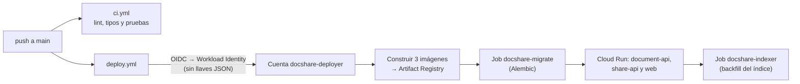

| Workflow | Qué hace |
|---|---|
| [`ci.yml`](.github/workflows/ci.yml) | En cada push y pull request: ruff, mypy estricto y pytest de ambos servicios contra Postgres con pgvector (`pgvector/pgvector:pg17`); eslint, prettier, tsc, Vitest y build del portal |
| [`deploy.yml`](.github/workflows/deploy.yml) | En cada push a `main` (o a mano con *Run workflow*): se autentica en GCP por **Workload Identity Federation**, construye y publica las imágenes etiquetadas con el commit, actualiza los jobs, ejecuta las migraciones **antes** de desplegar y luego despliega los tres servicios en Cloud Run ([`scripts/deploy.sh`](scripts/deploy.sh)) |

- **Sin secretos de GCP en GitHub:** el token OIDC de GitHub se cambia por credenciales de corta
  duración. El proveedor solo acepta tokens de este repositorio.
- **Permisos mínimos:** la cuenta de despliegue tiene `run.developer` y `artifactregistry.writer`,
  y solo puede actuar como las tres cuentas de servicio de runtime.
- **Configuración:** Terraform crea el pool y la cuenta cuando `github_repository` tiene valor. El
  workflow lee 5 variables del repositorio (`GCP_PROJECT_ID`, `GCP_REGION`, `GCP_NAME_PREFIX`,
  `GCP_WIF_PROVIDER` y `GCP_DEPLOYER_SA`).
- Los despliegues no se ejecutan en paralelo (`concurrency: deploy`).

## Estructura del repositorio

```
.
├── services/
│   ├── document-api/        # DMS existente (simulado)
│   └── share-api/
│       ├── app/
│       │   ├── api/         # routers FastAPI (v1)
│       │   ├── services/    # casos de uso: envíos, accesos, políticas, auditoría
│       │   ├── domain/      # entidades y reglas
│       │   ├── sensitivity/ # detectores y clasificador
│       │   ├── ai/          # indexación, recuperación, respuestas y agente
│       │   ├── adapters/    # DMS, storage, canales, proveedores externos
│       │   ├── db/          # modelos y migraciones Alembic
│       │   └── jobs/        # retención e indexación programadas
│       └── tests/           # unit/ e integration/
├── web/                     # portal React (src/, e2e/ con Playwright)
├── infra/terraform/         # infraestructura GCP
├── scripts/                 # deploy, demo y entorno híbrido
├── docs/                    # análisis, diseño, modelo de datos, IA y ADRs
├── docker-compose.yml       # base común
├── compose.local.yml        # Postgres, S3 y Mailpit locales
├── compose.hybrid.yml       # localhost conectado a GCP
└── Makefile
```

## Documentación

| Documento | Contenido |
|---|---|
| [01 · Análisis](docs/01-analisis.md) | Necesidad, preguntas, supuestos, riesgos, alcance y prioridades |
| [02 · Diseño](docs/02-diseno.md) | Arquitectura, componentes, flujos y justificación |
| [03 · Modelo de datos](docs/03-modelo-datos.md) | Tablas, índices e invariantes |
| [04 · Prototipo](docs/04-prototipo.md) | Ejecución, usuarios y recorrido del flujo |
| [05 · Limitaciones y roadmap](docs/05-limitaciones-y-roadmap.md) | Lo que falta y cómo seguir |
| [06 · Despliegue en GCP](docs/06-despliegue-gcp.md) | Terraform, Cloud Run, secretos y CI/CD |
| [07 · Entornos](docs/07-entornos.md) | `local`, `hybrid` y `gcp` |
| [08 · Inteligencia artificial](docs/08-ia.md) | RAG, agente, seguridad, costos y pruebas |
| [ADRs](docs/adr/) | 14 decisiones de arquitectura con sus alternativas |

## Autor

**Samir Gonzalez** · [github.com/samilr](https://github.com/samilr)
