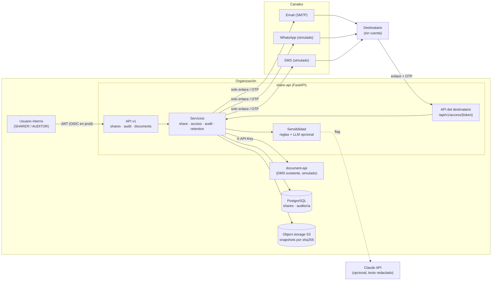
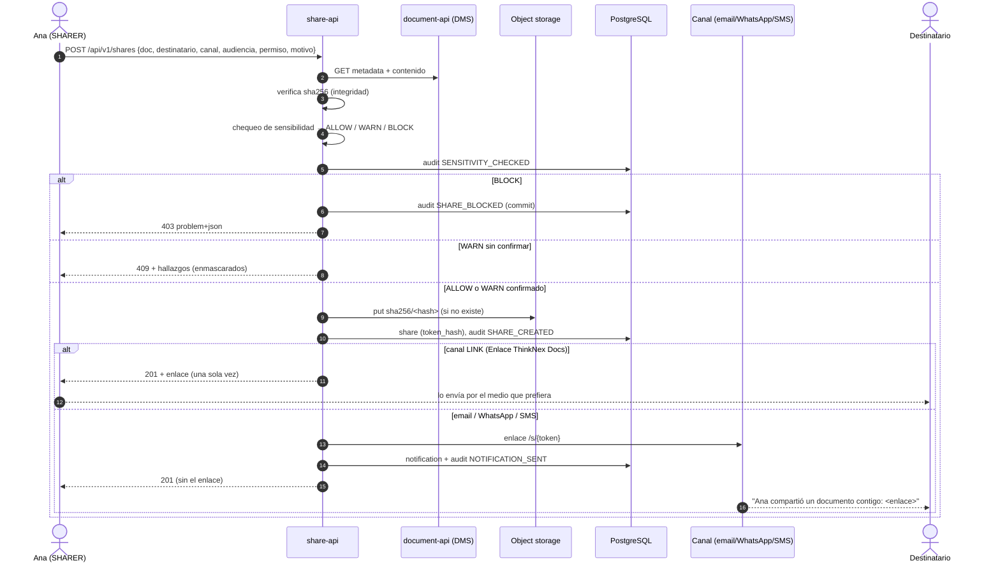
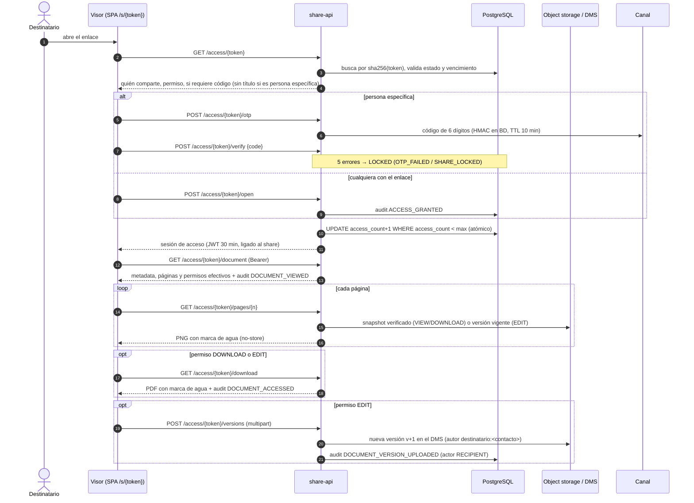

# 2. Diseño

## 2.1 Arquitectura

**Estilo:** monolito modular (un servicio, capas separadas) más el DMS como sistema externo. Es
proporcional al problema: un dominio acotado y un volumen moderado. Los módulos tienen límites
claros (puertos y adaptadores), así que se podrían extraer si el volumen lo justificara (ver
ADR-0001).

## 2.2 Componentes y responsabilidades

| Componente | Responsabilidad | Ubicación |
|---|---|---|
| `document-api` | Simula el sistema existente: catálogo, metadata con `sha256` y clasificación, y contenido | `services/document-api` |
| API v1 | Endpoints internos autenticados con roles | `app/api/v1/` |
| API del destinatario | Endpoints públicos del visor (`/api/v1/access/{token}/…`). La página `/s/{token}` es de la SPA | `app/api/public/` |
| `ShareService` | Caso de uso de compartir: verificar integridad, aplicar la política, tomar el snapshot, persistir, notificar y auditar | `app/services/share_service.py` |
| `AccessService` | Abrir enlace, OTP o apertura directa, sesión de acceso con consumo atómico, vista protegida, descarga y nuevas versiones según el permiso | `app/services/access_service.py` |
| `audit_service` | Auditoría append-only con cadena de hashes, consultas y verificación | `app/services/audit_service.py` |
| `retention_service` | Vencer shares y purgar snapshots sin uso | `app/services/retention_service.py` |
| Sensibilidad | Detectores (RUT, email, teléfono, tarjeta, cuenta), política y LLM opcional | `app/sensitivity/` |
| Adaptadores | DMS (HTTP), storage (S3), canales (SMTP y mocks), marca de agua (PDF) y render de páginas a PNG | `app/adapters/` |
| Composition root | Arma las dependencias concretas. Los tests inyectan fakes | `app/container.py` |

## 2.3 Flujo principal: compartir

La política se endurece para los enlaces (ADR-0010): "cualquiera con el enlace" solo se acepta si la
evaluación hacia un externo resulta `ALLOW`, y el permiso de edición no se admite para "cualquiera"
ni sobre documentos `RESTRICTED`.

## 2.4 Flujo del destinatario: visor de ThinkNex Docs

El enlace abre la SPA en `/s/{token}`; el visor usa la API pública `/api/v1/access/{token}`.

Las denegaciones (token desconocido, vencido, revocado, agotado o bloqueado) responden igual hacia
afuera (`404 link_unavailable`), y la causa real queda en la auditoría (`ACCESS_DENIED.reason`).

## 2.5 Decisiones de diseño y justificación

| Decisión | Alternativa descartada | Por qué |
|---|---|---|
| **Enlace + OTP**, el documento no viaja por el canal (ADR-0003) | Adjuntar el archivo | Sin enlace no hay revocación, expiración ni registro de accesos |
| **Snapshot inmutable por sha256** (ADR-0002) | Proxy en vivo al DMS | Lo compartido es exactamente lo descargado. Deduplica y no depende de que el DMS esté disponible |
| **Auditoría con cadena de hashes y trigger** (ADR-0004) | Tabla de logs simple | Evidencia de manipulación verificable a bajo costo |
| **Solo se guarda el hash del token** | Guardar el token | Un volcado de la BD no permite usar enlaces |
| **OTP como HMAC ligado al share** | OTP en claro | Un volcado no revela códigos y un código no sirve para otro share |
| **Respuesta uniforme a denegaciones** | Mensajes específicos | Evita enumerar enlaces. El detalle queda en la auditoría |
| **Abrir el enlace no consume accesos; iniciar la sesión sí** | Consumir al abrir | Los previsualizadores de email y WhatsApp abren los enlaces automáticamente. Solo la verificación o la apertura explícita cuentan |
| **Vista protegida renderizada en el servidor** (ADR-0010) | Visor PDF en el navegador con descarga oculta | Con permiso Ver el archivo nunca llega al cliente: solo imágenes con marca de agua |
| **El enlace se muestra una sola vez y se puede regenerar** (ADR-0010) | Guardar el enlace para volver a mostrarlo | Solo se guarda el hash del token. Regenerar invalida el anterior y queda auditado |
| **IA solo puede advertir, nunca bloquear** (ADR-0005) | Decisión automática por LLM | Un falso positivo no debe impedir trabajar. La persona decide con la información a la vista |
| **SQLAlchemy síncrono** | async | boto3 y smtplib son síncronos. El threadpool de FastAPI basta para el volumen esperado |
| **Problem Details (RFC 7807)** | Errores ad hoc | Contrato de errores estándar y extensible (`report`, `remaining_attempts`) |

## 2.6 Portal, autenticación y despliegue

- **Portal web** (React + Vite + TypeScript) servido en el mismo origen que la API mediante nginx (ADR-0008).
- **Explorador de documentos estilo SharePoint** (ADR-0009):
  - bibliotecas por área y carpetas con migas de pan;
  - subida con arrastrar y soltar, y versiones;
  - panel del archivo con vista previa (marca de agua y auditoría), detalles e historial,
    **Personas con acceso** (permiso, revocación y nuevo enlace), actividad y **Compartir** desde el
    propio archivo.
- **Visor del destinatario** en `/s/{token}`, fuera de la sesión interna (ADR-0010): verificación
  con código o apertura directa, páginas con marca de agua y zoom, **Descargar** solo si el permiso
  lo permite y **Subir nueva versión** con permiso de edición.
- **Autenticación propia** con roles ADMIN, SHARER y AUDITOR, y refresh token rotativo (ADR-0007).
- **Despliegue en GCP:** Cloud Run, Cloud SQL, Cloud Storage y Secret Manager con Terraform (ADR-0006, [06-despliegue-gcp.md](06-despliegue-gcp.md)).

## 2.7 Seguridad transversal

- **Secretos** solo por variables de entorno (`.env` local, gestor de secretos en producción). La
  configuración exige al menos 32 caracteres para `JWT_SECRET` y `OTP_SECRET`.
- **Logs** en JSON con `request_id`. Las rutas con token (`/s/…` y `/api/v1/access/…`) se registran
  como `…/***`, el access log de uvicorn está desactivado y nginx no registra esas rutas.
- **Headers** en la API del destinatario: `Cache-Control: no-store`, `Referrer-Policy: no-referrer`,
  `X-Content-Type-Options: nosniff` y `X-Frame-Options: DENY`. La SPA usa `Referrer-Policy:
  no-referrer` y CSP sin scripts en línea.
- **Contenedores** sin root, con imágenes multi-stage y healthchecks.
- **Integridad** del contenido verificada dos veces: al leer del DMS y al servir el snapshot.
