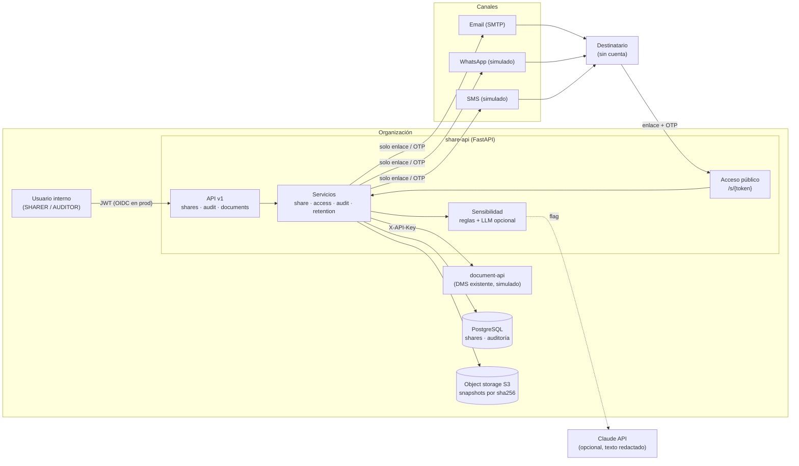
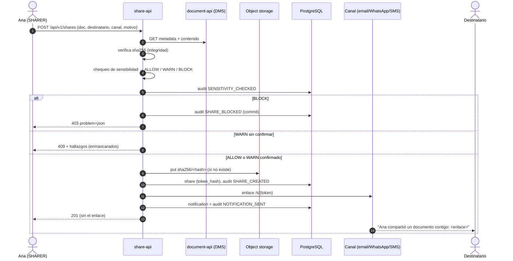
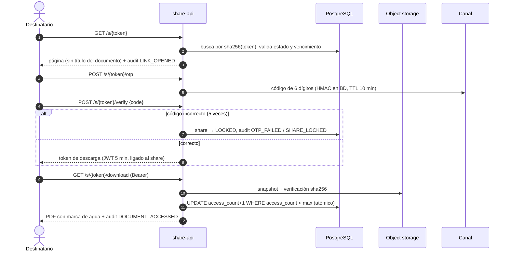

# 2. Diseño

## 2.1 Arquitectura

**Estilo:** monolito modular (un servicio, capas separadas) más el DMS como sistema externo. Es
proporcional al problema: un dominio acotado y un volumen moderado. Los módulos tienen límites
claros (puertos y adaptadores), así que se podrían extraer si el volumen lo justificara (ver
ADR-0001).

## 2.2 Componentes y responsabilidades

| Componente | Responsabilidad | Ubicación |
|---|---|---|
| `document-api` | Simula el sistema existente: catálogo, metadata con `sha256` y clasificación, y contenido | `services/document-api` |
| API v1 | Endpoints internos autenticados con roles | `app/api/v1/` |
| Acceso público | Página y endpoints del destinatario (`/s/{token}`) | `app/api/public/` |
| `ShareService` | Caso de uso de compartir: verificar integridad, aplicar la política, tomar el snapshot, persistir, notificar y auditar | `app/services/share_service.py` |
| `AccessService` | Abrir enlace, OTP, verificación, descarga con consumo atómico y marca de agua | `app/services/access_service.py` |
| `audit_service` | Auditoría append-only con cadena de hashes, consultas y verificación | `app/services/audit_service.py` |
| `retention_service` | Vencer shares y purgar snapshots sin uso | `app/services/retention_service.py` |
| Sensibilidad | Detectores (RUT, email, teléfono, tarjeta, cuenta), política y LLM opcional | `app/sensitivity/` |
| Adaptadores | DMS (HTTP), storage (S3), canales (SMTP y mocks), marca de agua (PDF) | `app/adapters/` |
| Composition root | Arma las dependencias concretas. Los tests inyectan fakes | `app/container.py` |

## 2.3 Flujo principal: compartir

## 2.4 Flujo del destinatario: acceso

Las denegaciones (token desconocido, vencido, revocado, agotado o bloqueado) responden igual hacia
afuera (`404 link_unavailable`), y la causa real queda en la auditoría (`ACCESS_DENIED.reason`).

## 2.5 Decisiones de diseño y justificación

| Decisión | Alternativa descartada | Por qué |
|---|---|---|
| **Enlace + OTP**, el documento no viaja por el canal (ADR-0003) | Adjuntar el archivo | Sin enlace no hay revocación, expiración ni registro de accesos |
| **Snapshot inmutable por sha256** (ADR-0002) | Proxy en vivo al DMS | Lo compartido es exactamente lo descargado. Deduplica y no depende de que el DMS esté disponible |
| **Auditoría con cadena de hashes y trigger** (ADR-0004) | Tabla de logs simple | Evidencia de manipulación verificable a bajo costo |
| **Solo se guarda el hash del token** | Guardar el token | Un volcado de la BD no permite usar enlaces |
| **OTP como HMAC ligado al share** | OTP en claro | Un volcado no revela códigos y un código no sirve para otro share |
| **Respuesta uniforme a denegaciones** | Mensajes específicos | Evita enumerar enlaces. El detalle queda en la auditoría |
| **GET de la página no consume accesos** | Consumir al abrir | Los previsualizadores de email y WhatsApp abren los enlaces automáticamente |
| **IA solo puede advertir, nunca bloquear** (ADR-0005) | Decisión automática por LLM | Un falso positivo no debe impedir trabajar. La persona decide con la información a la vista |
| **SQLAlchemy síncrono** | async | boto3 y smtplib son síncronos. El threadpool de FastAPI basta para el volumen esperado |
| **Problem Details (RFC 7807)** | Errores ad hoc | Contrato de errores estándar y extensible (`report`, `remaining_attempts`) |

## 2.6 Seguridad transversal

- **Secretos** solo por variables de entorno (`.env` local, gestor de secretos en producción). La
  configuración exige al menos 32 caracteres para `JWT_SECRET` y `OTP_SECRET`.
- **Logs** en JSON con `request_id`. Las rutas `/s/{token}` se registran como `/s/***` y el access
  log de uvicorn está desactivado.
- **Headers** en `/s/*`: `Cache-Control: no-store`, `Referrer-Policy: no-referrer`,
  `X-Frame-Options: DENY` y CSP estricta con nonce.
- **Contenedores** sin root, con imágenes multi-stage y healthchecks.
- **Integridad** del contenido verificada dos veces: al leer del DMS y al servir el snapshot.
