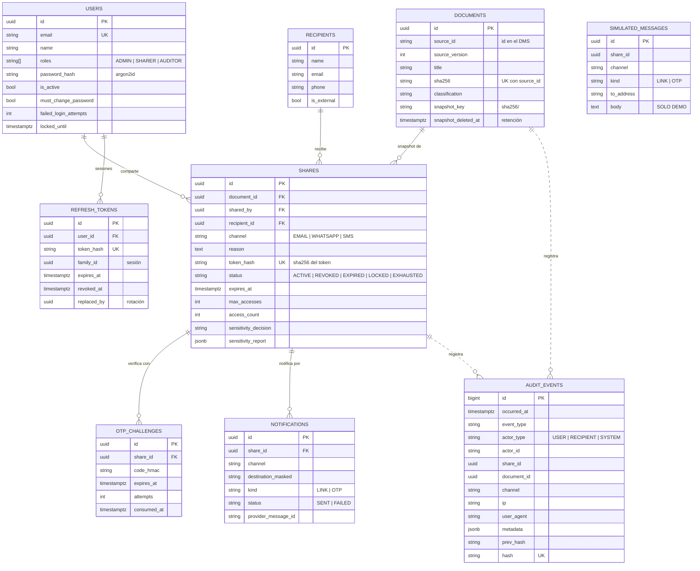
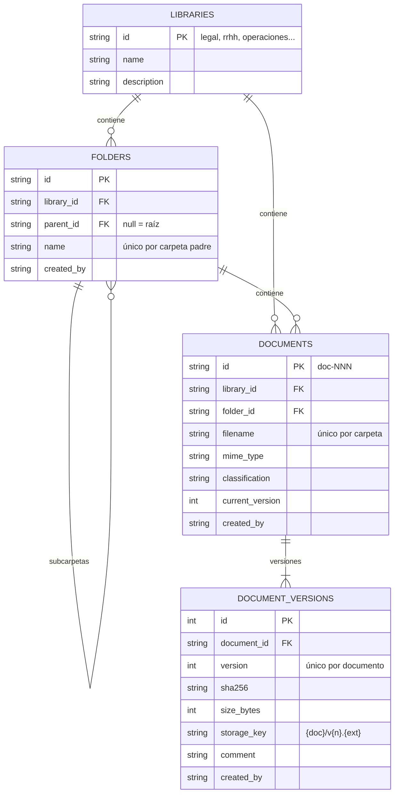

# 3. Modelo de datos

PostgreSQL 17. Migraciones con Alembic: [`0001_initial.py`](../services/share-api/app/db/migrations/versions/0001_initial.py)
(dominio y auditoría) y [`0002_auth_roles.py`](../services/share-api/app/db/migrations/versions/0002_auth_roles.py)
(autenticación, roles y bandeja simulada).

## Diccionario y decisiones

**`shares`: el corazón del modelo.** Cada fila responde a la pregunta del negocio:
**quién** (`shared_by`), **qué** (`document_id`, que es un snapshot con hash), **a quién**
(`recipient_id`), **cuándo** (`created_at`), **por qué medio** (`channel`) y **para qué** (`reason`).
Las restricciones `CHECK` garantizan valores válidos de `channel` y `status`, y que
`0 ≤ access_count ≤ max_accesses`.

**`documents`: snapshot, no espejo del DMS.** Una fila por `(source_id, sha256)`: si el documento
cambia en el DMS, el próximo share crea un snapshot nuevo y los anteriores siguen apuntando a lo que
realmente se compartió. `snapshot_key` es direccionado por contenido, así que compartir 10 veces el
mismo archivo lo guarda una sola vez.

**`recipients`**: se reutilizan por email o teléfono. `is_external` sigue el supuesto S1 (dominio
corporativo). `CHECK` exige al menos un dato de contacto.

**`otp_challenges`**: solo se guarda el HMAC del código. Un único código vigente por share (los
anteriores se marcan consumidos), con un máximo de 5 intentos por código y 5 códigos por share.

**`notifications`**: registro técnico de cada envío, con el destino enmascarado y el id del proveedor
para conciliar con WhatsApp o SMS. Nunca guarda el cuerpo del mensaje, porque contiene el enlace o el
OTP.

**`users` y `refresh_tokens`: autenticación.** Varios roles por usuario (`roles[]`, con un CHECK
sobre los valores válidos). La contraseña se guarda con argon2id; el refresh token solo como hash.
`family_id` agrupa las rotaciones de una sesión: si se presenta un token ya rotado, se revoca la
familia completa (ADR-0007).

**`simulated_messages`: solo demo.** Copia legible de lo que recibe el destinatario (incluye
enlace y OTP) para probar el flujo sin canales reales. Tiene TTL de 7 días, la purga el job de
retención y se apaga con `SIMULATED_INBOX_ENABLED=false`.

**`audit_events`: append-only y encadenada.**
- Sin claves foráneas a propósito: la auditoría debe sobrevivir a cualquier limpieza de otras tablas.
- `hash = sha256(prev_hash ‖ JSON canónico del evento)`. `GET /api/v1/audit/verify` la recalcula.
- Los triggers `audit_events_no_update_delete` y `audit_events_no_truncate` rechazan cualquier
  modificación, incluso de la propia aplicación.
- `metadata` nunca contiene datos personales en claro: contactos enmascarados, conteos de hallazgos
  por tipo y el `sha256` del documento (prueba de qué se compartió aun después de purgar el contenido).

### Catálogo de eventos de auditoría

| Evento | Actor | Cuándo |
|---|---|---|
| `SENSITIVITY_CHECKED` | USER | Al evaluar un documento para compartir (incluye la decisión) |
| `SHARE_BLOCKED` | USER | Política impidió compartir |
| `SHARE_CREATED` | USER | Share creado (motivo, vencimiento, límites, hash) |
| `NOTIFICATION_SENT` / `NOTIFICATION_FAILED` | SYSTEM | Envío del enlace por el canal |
| `LINK_OPENED` | RECIPIENT | Apertura de la página |
| `OTP_SENT` / `OTP_VERIFIED` / `OTP_FAILED` | RECIPIENT | Verificación de identidad |
| `DOCUMENT_ACCESSED` | RECIPIENT | Descarga (número de acceso y marca de agua) |
| `ACCESS_DENIED` | RECIPIENT | Cualquier denegación, con la causa real |
| `SHARE_REVOKED` | USER | Revocación |
| `SHARE_EXPIRED` / `SHARE_LOCKED` | SYSTEM | Vencimiento o bloqueo por intentos |
| `SNAPSHOT_PURGED` | SYSTEM | Retención: contenido eliminado, hash conservado |
| `USER_LOGIN` / `USER_LOGIN_FAILED` / `USER_LOCKED` / `USER_LOGOUT` | USER | Sesiones (los fallidos con email enmascarado) |
| `USER_CREATED` / `USER_UPDATED` / `USER_DISABLED` / `USER_ENABLED` | USER (ADMIN) | Administración de cuentas, con el detalle de cambios |
| `PASSWORD_CHANGED` / `PASSWORD_RESET` | USER | Cambio propio o reinicio por un ADMIN |
| `TOKEN_REUSE_DETECTED` | USER | Refresh token ya rotado presentado de nuevo: sesión revocada |

### Índices

`shares(token_hash)` único (búsqueda por enlace), `shares(shared_by)`,
`audit_events(document_id, occurred_at)`, `audit_events(actor_id)`, `audit_events(share_id)` y
`otp_challenges(share_id, created_at)`.

## Sistema documental (document-api, base `dms`)

El enlace entre ambos modelos es `documents.source_id` (share-api) = `documents.id` (DMS). Cada envío
apunta a un **snapshot** de la versión vigente al momento de compartir, así que publicar una nueva
versión no cambia lo que ya recibió un destinatario (ADR-0002, ADR-0009).

Eventos de auditoría de la biblioteca: `DOCUMENT_UPLOADED`, `DOCUMENT_VERSION_UPLOADED`,
`DOCUMENT_VIEWED` (vista o descarga interna, con versión y modo) y `FOLDER_CREATED`.
