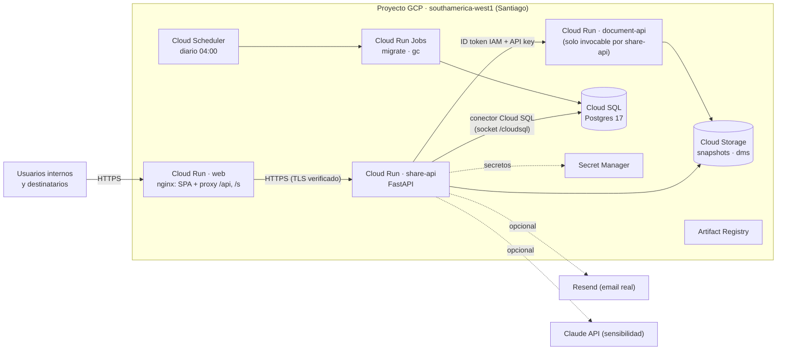

# 6. Despliegue en Google Cloud

La plataforma completa se despliega en GCP con **Terraform** (`infra/terraform`) y un script de build y
deploy (`scripts/deploy.sh`). Todo es reproducible y se puede destruir con un comando.

## 6.1 Arquitectura en la nube



| Pieza | Decisión | Por qué |
|---|---|---|
| Cómputo | Cloud Run con mínimo 0 instancias | Costo casi nulo en una demo; HTTPS administrado |
| Una sola URL | nginx en `web` hace de proxy de `/api` y `/s` | Mismo origen: cookie `SameSite=Strict` sin CORS y sin pagar un Load Balancer (ADR-0008) |
| DMS privado | `document-api` sin `allUsers`; `run.invoker` solo para la cuenta de servicio de share-api | Simula un sistema interno: Internet no puede llamarlo (responde 403) |
| Base de datos | Cloud SQL con IP pública **sin redes autorizadas** | Solo es accesible con el conector de Cloud SQL (IAM y TLS); evita pagar VPC y conector serverless |
| Secretos | Generados por Terraform (`random_password`) en Secret Manager | Nada en el código ni en las imágenes; cada servicio lee solo lo suyo |
| Identidades | Una cuenta de servicio por componente, sin llaves JSON | Mínimo privilegio; CI con Workload Identity Federation |
| Migraciones | Cloud Run Job ejecutado antes de desplegar | Evita que varias instancias migren a la vez |
| Retención | Job `gc` diario + regla de ciclo de vida de 30 días en el bucket | Doble protección contra copias olvidadas |

## 6.2 Requisitos

- Una cuenta de Google con facturación y los CLIs `gcloud` y `terraform` (por ejemplo: `brew install --cask gcloud-cli` y `brew install hashicorp/tap/terraform`).
- Docker con `buildx`. Las imágenes se construyen para `linux/amd64`.
- `jq`.

## 6.3 Runbook

```bash
gcloud auth login
gcloud auth application-default login   # o: export GOOGLE_OAUTH_ACCESS_TOKEN=$(gcloud auth print-access-token)

# 1. Proyecto con facturación (o uno existente)
gcloud projects create <PROJECT_ID>
gcloud billing projects link <PROJECT_ID> --billing-account=<BILLING_ID>

# 2. Bucket del estado de Terraform + APIs mínimas
make gcp-bootstrap PROJECT_ID=<PROJECT_ID>

# 3. Variables del ambiente
cp infra/terraform/demo.tfvars.example infra/terraform/demo.tfvars   # completar project_id

# 4. Infraestructura (revisar el plan antes de aplicar)
make gcp-plan
make gcp-apply

# 5. Imágenes + migraciones + despliegue (equivale a: make up APP_ENV=gcp)
make gcp-deploy

# 6. Credenciales iniciales (generadas por Terraform)
terraform -chdir=infra/terraform output -raw admin_password
terraform -chdir=infra/terraform output -raw demo_users_password
```

La primera vez, Terraform crea los servicios con una imagen de ejemplo de Google (`hello`), y
`deploy.sh` la reemplaza por las imágenes reales. En adelante, Terraform ignora la imagen: los
despliegues de código no tocan la infraestructura y viceversa.

### Despliegue continuo (opcional)

Con `github_repository = "owner/repo"` en `demo.tfvars`, Terraform crea el pool de Workload Identity
y una cuenta `deployer`. Hay que cargar como variables del repositorio en GitHub `GCP_PROJECT_ID`,
`GCP_REGION`, `GCP_NAME_PREFIX`, `GCP_WIF_PROVIDER` y `GCP_DEPLOYER_SA` (ver `terraform output`).
Desde ese momento, `.github/workflows/deploy.yml` despliega en cada push a `main`.

### Integraciones opcionales

| Variable de `demo.tfvars` | Efecto |
|---|---|
| `resend_api_key`, `email_from` | Email real con Resend. El remitente debe estar en un dominio verificado; si no, Resend solo entrega al dueño de la cuenta |
| `anthropic_api_key` | Activa el chequeo de sensibilidad con Claude |
| `simulated_inbox_enabled = false` | Apaga la bandeja simulada; recomendado fuera de la demo |
| `demo_users_enabled = false` | No crea los usuarios ficticios |

Para trabajar desde tu equipo contra esta misma infraestructura (contenedores locales conectados a
Cloud SQL y Cloud Storage) existe el perfil `APP_ENV=hybrid`: ver [07-entornos.md](07-entornos.md).

## 6.4 Operación

- **Logs:** Cloud Logging, en JSON con `request_id`; los tokens de enlace aparecen como `/s/***`. Filtro útil: `resource.labels.service_name="docshare-share-api"`.
- **Retención manual:** `gcloud run jobs execute docshare-gc --region southamerica-west1 --wait`.
- **Rotar un secreto:** `gcloud secrets versions add docshare-jwt-secret --data-file=-` y después redesplegar `share-api`. Los servicios leen la versión `latest` al arrancar. Rotar `jwt-secret` invalida los access tokens vigentes, y quienes estén conectados vuelven a entrar con su refresh token.
- **Estado de Terraform:** `gs://<PROJECT_ID>-tfstate`, privado y versionado. Contiene los secretos generados, así que el acceso a ese bucket debe tratarse como acceso a los secretos.

## 6.5 Costos y apagado

| Recurso | Costo aproximado al mes |
|---|---|
| Cloud SQL `db-f1-micro` + 10 GB SSD + backups | US$9–12 |
| Cloud Run (escala a cero), Storage, Secret Manager, Registry, Scheduler | < US$2 |

Cuando la demo ya no se necesite:

```bash
make gcp-destroy        # elimina todo lo creado por Terraform
gcloud projects delete <PROJECT_ID>   # opcional: elimina también el proyecto y el bucket de estado
```

## 6.6 Limitaciones conscientes de este despliegue

- **Sin VPC privada.** Cloud SQL usa IP pública restringida al conector. En producción se usaría IP privada con *Direct VPC egress* desde Cloud Run.
- **Sin dominio propio ni WAF.** En producción iría un Load Balancer HTTPS con Cloud Armor (rate limiting y reglas OWASP) y un dominio corporativo.
- **IP de auditoría:** se toma de `X-Forwarded-For`. Detrás del proxy de Google es confiable, pero el primer valor puede venir del cliente. Con un Load Balancer se usaría la IP que este garantiza.
- **Bandeja simulada activa:** es intencional para que la evaluación sea autónoma; en producción se apaga.
