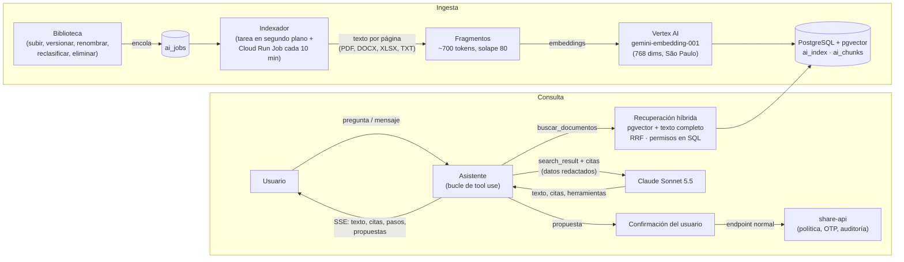

# 8. Inteligencia artificial

La IA de ThinkNex Docs tiene dos objetivos:

- **encontrar y entender** documentos (RAG con citas);
- **operar la plataforma conversando** (asistente agéntico).

Ninguno debe romper los principios del sistema: permisos, auditoría y que la IA nunca ejecute sola
algo que no se puede deshacer.

Decisiones: [ADR-0013](adr/0013-rag-pgvector-vertex.md) (recuperación y respuestas) y
[ADR-0014](adr/0014-asistente-agentico.md) (asistente). Antecedente:
[ADR-0005](adr/0005-ia-proporcional.md), el clasificador de sensibilidad.

## 8.1 Qué hace

| Capacidad | Quién | Dónde |
|---|---|---|
| **Asistente** con herramientas, citas y propuestas de acción | SHARER y ADMIN. El AUDITOR solo con herramientas de auditoría | Botón flotante en todas las pantallas, botón en cada documento y página *Asistente* con historial |
| **Búsqueda híbrida** (semántica y por texto) en los documentos visibles | SHARER y ADMIN | `GET /api/v1/ai/search` |
| **Pregunta con citas** sobre los documentos | SHARER y ADMIN | `POST /api/v1/ai/ask` (SSE) |
| **Índice** de documentos (fragmentos y embeddings) | Automático | Al subir, versionar, renombrar, reclasificar o eliminar |
| **Sensibilidad asistida** al compartir: solo advierte | Automático | Revisión de seguridad del asistente de compartir |

## 8.2 Arquitectura



Todo vive en `services/share-api/app/ai/`, con el patrón de puertos y adaptadores del proyecto
(ADR-0001):

| Módulo | Responsabilidad |
|---|---|
| `providers.py` | `Embedder`: `VertexEmbedder` por REST con credenciales de la cuenta de servicio, o `FakeEmbedder` determinista para tests y local |
| `llm.py` | `ClaudeLlm`: streaming de respuestas y turnos con herramientas. Traduce los eventos del SDK a eventos propios (texto, cita, fin de bloque, herramienta, fin de turno) |
| `extract.py`, `chunking.py` | Texto por página y fragmentación con solape |
| `index_service.py`, `worker.py`, `jobs.py` | Cola, sincronización idempotente y procesamiento |
| `retrieval.py` | Recuperación híbrida con alcance y permisos |
| `answer_service.py` | Respuestas con citas (RAG) y redacción |
| `tools.py`, `agent.py` | Herramientas del asistente y su bucle agéntico |
| `usage.py` | Consumo por usuario y presupuesto diario |

## 8.3 Indexación

- **Formatos:**
  - PDF por página real;
  - DOCX en bloques de 40 párrafos más las tablas;
  - XLSX por hoja;
  - TXT.
  - Un PDF escaneado o una imagen no tienen texto: quedan `EMPTY` (pendiente: OCR).
- **Fragmentos:** ~700 tokens con 80 de solape, respetando párrafos. Cada fragmento conserva su
  página inicial y final: lo que se cita es la página.
- **Embeddings:** Vertex AI `gemini-embedding-001`, con 768 dimensiones y tipos de tarea
  `RETRIEVAL_DOCUMENT` y `RETRIEVAL_QUERY`.
  - Región `southamerica-east1`: el modelo no existe en Santiago. Se verificó contra el proyecto.
  - El título del documento acompaña a cada fragmento al calcular su embedding.
- **Sincronización idempotente** por documento y `sha256`:
  - indexa la versión vigente y deja las anteriores para los snapshots ya compartidos;
  - actualiza el nombre, la carpeta y la clasificación sin recalcular los embeddings;
  - borra todo al eliminar el archivo.
- **Exclusión:** los documentos `RESTRICTED` quedan `SKIPPED` (`AI_EXCLUDE_RESTRICTED=true`).
- **Ejecución:**
  1. cada cambio en la biblioteca inserta un trabajo en `ai_jobs` (un pendiente por documento);
  2. una tarea en segundo plano lo procesa tras la respuesta;
  3. el Cloud Run Job `docshare-indexer` corre cada 10 minutos como respaldo;
  4. `make ai-index` hace el backfill completo.
- **Estado visible:** en el panel del archivo, *Detalles → Índice de IA* (Indexado, En cola, Sin
  texto, Excluido o Error).

## 8.4 Recuperación y respuestas (RAG)

1. **Recuperación híbrida:**
   - hasta 30 candidatos por similitud de coseno (HNSW, `hnsw.ef_search = 100`);
   - hasta 30 por texto completo en español (`websearch_to_tsquery('spanish')`, `ts_rank_cd`);
   - se fusionan con **Reciprocal Rank Fusion** (k = 60) y quedan los 8 mejores.

   La búsqueda por texto rescata nombres propios, códigos y cifras; la semántica, los sinónimos y
   las paráfrasis.
2. **Permisos y alcance en el SQL:**
   - solo versiones vigentes indexadas;
   - opcionalmente, una biblioteca, una carpeta o ciertos documentos;
   - para el destinatario (pendiente), un único índice.

   El modelo nunca recibe fragmentos de documentos que el usuario no puede abrir.
3. **Respuesta con citas nativas:**
   - cada fragmento va como bloque `search_result` (título con página y contenido por párrafos),
     con `citations` activadas;
   - Claude devuelve citas `search_result_location` que la app traduce a fuente numerada:
     documento y página;
   - en el portal, la cita `[n]` abre el documento en esa página.
4. **Sin evidencia, no inventa:** si no hay fragmentos, la respuesta lo dice sin llamar al modelo.
   El system prompt exige responder solo con los resultados.

## 8.5 Asistente agéntico

**Bucle:**
- Messages API con tool use en streaming (`claude-sonnet-5-5`, thinking adaptativo, effort `medium`).
- Máximo 8 pasos por mensaje.
- Prompt caching del system prompt y del prefijo de la conversación.
- El historial se reconstruye de `ai_messages`, con los últimos 30 mensajes.

**Herramientas** (`app/ai/tools.py`). Se ejecutan con la identidad del usuario sobre los servicios
existentes:

| Herramienta | Roles | Qué hace |
|---|---|---|
| `buscar_documentos` | SHARER, ADMIN | Recuperación híbrida. Devuelve resultados citables |
| `leer_documento` | SHARER, ADMIN | Primeros 12 fragmentos en orden (para resumir). Citable |
| `listar_documentos` / `ver_documento` | SHARER, ADMIN | Catálogo del DMS, ficha, versiones y envíos activos |
| `listar_envios` | SHARER, ADMIN, AUDITOR | Envíos visibles: los propios, o todos para supervisión |
| `revisar_politica` | SHARER, ADMIN | Precheck de la política. No comparte nada |
| `consultar_auditoria` | ADMIN, AUDITOR | Eventos recientes, filtrables |
| `proponer_envio` / `proponer_revocacion` / `proponer_cambio_acceso` | SHARER, ADMIN | **Solo crean una propuesta** (auditada como `AI_ACTION_PROPOSED`) |

**Flujo de una acción:**
1. El asistente propone; la interfaz muestra una tarjeta.
2. Al confirmar:
   - **Revisar y compartir** abre el asistente de compartir ya completado, con la revisión de
     seguridad y la confirmación de datos sensibles de siempre;
   - **Revocar** y **Aplicar cambio** llaman al endpoint normal.
3. El resultado se registra (`AI_ACTION_CONFIRMED`) y se agrega como nota del sistema al próximo
   turno. El estado de la tarjeta queda guardado en la conversación.

**Contexto de pantalla:**
- el mensaje lleva la ruta y, si viene de un documento, su id y título;
- las sugerencias iniciales cambian según la pantalla (documento, Envíos, Documentos, Auditoría).

**Citas entre turnos:** los índices de Claude son globales sobre todos los `search_result` de la
solicitud. El agente los recorre en orden para traducir cada cita a su fuente, incluso cuando vienen
de búsquedas de turnos anteriores.

**Conversaciones:**
- `ai_conversations` y `ai_messages` guardan el transcript de la API (para continuar) y una versión
  visible (para mostrar);
- solo el dueño las ve;
- se purgan tras 30 días sin uso (job de retención).

**Interfaz:**
- botón flotante con un panel lateral en todo el portal;
- botón *Asistente* en cada documento y en su panel;
- página *Asistente* estilo chat, con el historial a la izquierda.

## 8.6 Seguridad, privacidad y gobierno

| Riesgo | Mitigación |
|---|---|
| Fuga entre usuarios | Permisos aplicados en el SQL de recuperación y herramientas filtradas por rol. Conversaciones solo del dueño (404 para otros) |
| Datos personales hacia el LLM | Se redactan RUT, tarjetas y cuentas (`[RUT]`, `[CARD]`, `[BANK_ACCOUNT]`) antes de enviar. `RESTRICTED` queda fuera del índice. La pregunta se audita redactada |
| Prompt injection desde un documento | Los documentos entran como datos (`search_result`), y el system prompt ordena ignorar instrucciones dentro de ellos. Las herramientas que cambian algo solo proponen: un documento malicioso no puede compartir, revocar ni modificar nada sin un clic humano |
| Acciones no deseadas | Toda acción pasa por los endpoints normales: política, OTP, auditoría y permisos del usuario |
| Trazabilidad | `AI_QUERY` (pregunta redactada, herramientas y documentos citados), `AI_ACTION_PROPOSED` y `AI_ACTION_CONFIRMED`. Actuar como otro usuario agrega `impersonated_by` (ADR-0012) |
| Costo descontrolado | Presupuesto diario de tokens por usuario (`AI_DAILY_TOKEN_BUDGET`, 600 000 por defecto), máximo de pasos y registro en `ai_usage` |
| Residencia de datos | Embeddings en Vertex AI São Paulo, dentro del proyecto GCP. Las respuestas, en la API de Anthropic, con fragmentos redactados |

## 8.7 Modelos y costos

| Uso | Modelo | Precio de referencia (por millón de tokens) |
|---|---|---|
| Asistente y respuestas RAG | `claude-sonnet-5-5` | US$2 de entrada y US$10 de salida (lecturas de caché: US$0,10) |
| Sensibilidad y tareas de alto volumen | `claude-haiku-5-5` | US$0,10 y US$0,50 (con prompts de hasta 100K tokens) |
| Embeddings | Vertex `gemini-embedding-001` | Según la tarifa de Vertex AI; costo marginal con este volumen |

**Medido en el prototipo:** una pregunta típica usa ~1 700 tokens de entrada y ~180 de salida, unos
US$0,005. Un turno del asistente con dos o tres herramientas usa ~4 000 a 8 000 de entrada. El uso
real por usuario y función queda en `ai_usage`.

## 8.8 Configuración

| Variable | Por defecto | Uso |
|---|---|---|
| `AI_ENABLED` | `true` en Docker y Terraform | Activa índice, búsqueda, preguntas y asistente |
| `ANTHROPIC_API_KEY` | — | Activa el LLM. En GCP viaja como secreto de Secret Manager |
| `AI_CHAT_MODEL` / `AI_FAST_MODEL` | `claude-sonnet-5-5` / `claude-haiku-5-5` | Modelos |
| `EMBEDDINGS_PROVIDER` | `fake` en local; `vertex` en `hybrid` y `gcp` | Proveedor de embeddings |
| `VERTEX_PROJECT` / `VERTEX_LOCATION` | Proyecto de Terraform / `southamerica-east1` | Vertex AI |
| `AI_REDACT_PII` / `AI_EXCLUDE_RESTRICTED` | `true` / `true` | Privacidad |
| `AI_DAILY_TOKEN_BUDGET` | `600000` | Tope diario por usuario |
| `AI_CHUNK_TOKENS` / `AI_CHUNK_OVERLAP_TOKENS` | `700` / `80` | Fragmentación |

Sin `ANTHROPIC_API_KEY`, el portal oculta el asistente y la API responde `503 ai_unavailable`. El
índice y la búsqueda siguen funcionando.

## 8.9 Operación

```bash
make ai-index                 # local: backfill del índice (todos los documentos)
make ai-index APP_ENV=gcp     # nube: ejecuta el Cloud Run Job docshare-indexer --backfill
```

- **Un documento no aparece en las respuestas:** revisar *Detalles → Índice de IA*.
  - `EMPTY`: no tiene texto extraíble (escaneado).
  - `SKIPPED`: es `RESTRICTED`.
  - `FAILED`: ver `ai_jobs.last_error`.
- **Cambiar el modelo de embeddings:** el índice guarda `embedding_model`, y un backfill reindexa lo
  que no coincide.

## 8.10 Pruebas

- **Unitarias:**
  - fragmentación (tamaño, páginas, solape);
  - extracción PDF, DOCX, XLSX y TXT;
  - `FakeEmbedder`.
- **Integración** (Postgres con pgvector, `FakeEmbedder` y un LLM simulado con guiones):
  - indexación por cambios de la biblioteca y backfill;
  - búsqueda híbrida con alcance;
  - redacción antes del LLM;
  - auditoría y presupuesto;
  - el agente busca y cita, conserva el historial, solo propone y registra notas;
  - herramientas filtradas por rol.
- **Vitest:** streaming del chat, citas, tarjetas de propuesta y página con historial.
- **E2E con IA real** (`web/e2e/ai.spec.ts`, se omite si la IA no está disponible):
  - el asistente flotante responde con citas y guarda la conversación;
  - el botón del documento ofrece sugerencias de contexto.

## 8.11 Pendiente

- **Preguntas del destinatario** en el visor público, limitadas a su snapshot y con una opción por
  envío.
- **IA de gobierno:**
  - sugerencia de clasificación y resumen al subir;
  - política desde lenguaje natural;
  - explicación de la auditoría con detección de anomalías.
- **Evals de RAG** con un conjunto de preguntas de oro:
  - recall@k;
  - exactitud de las citas;
  - fidelidad (juez LLM);
  - rechazo cuando no hay respuesta;
  - fuga de permisos = 0;
  - resistencia a prompt injection.
- **OCR** para PDF escaneados e imágenes (visión de Claude Haiku).
